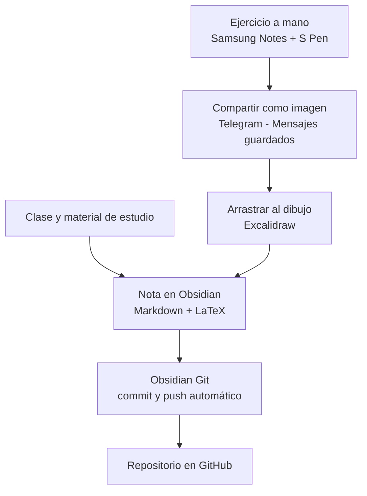

# Flujo de trabajo de apuntes

> [!summary] Resumen
> **Obsidian** es el eje de los apuntes. **Samsung Notes** se usa para resolver problemas a mano. Las imágenes pasan al PC por **Telegram** y se integran con **Excalidraw**. **Obsidian Git** sube todo a GitHub automáticamente.



---

## Herramientas y su papel

| Herramienta | Uso |
|---|---|
| Obsidian (PC) | Eje de los apuntes: teoría, definiciones, resultados |
| Latex Suite | Escribir fórmulas LaTeX rápido con atajos |
| Excalidraw (plugin) | Esquemas, diagramas e integración de ejercicios a mano |
| Samsung Notes (tablet) | Resolución de problemas con el S Pen |
| Telegram | Puente tablet → PC (Mensajes guardados) |
| Obsidian Git | Commit y push automáticos a GitHub |

---

## Flujo diario

### 1. Teoría en Obsidian
- Tomar apuntes de clase y del material directamente en Obsidian.
- Fórmulas en LaTeX: `$...$` en línea, `$$...$$` en bloque.
- Usar callouts para destacar: `> [!theorem]`, `> [!definition]`, `> [!example]`.
- Enlazar conceptos compartidos entre asignaturas con `[[...]]`.

### 2. Problemas en Samsung Notes
- Resolver con el S Pen en la carpeta de la asignatura (más adelante, por temas).

### 3. Pasar el ejercicio al PC
1. En Samsung Notes: **Compartir → Archivo de imagen → Telegram → Mensajes guardados**.
2. En el PC, abrir Telegram Desktop.
3. **Arrastrar** la imagen al lienzo de Excalidraw (o clic derecho → Copiar imagen → `Ctrl + V`).

### 4. Integrar en la nota
1. Con el cursor en la nota, pulsar **`Ctrl + Alt + E`** (crea el dibujo y lo incrusta).
2. Renombrar el dibujo con un nombre descriptivo, sin espacios ni símbolos (ej. `ej3-diagonalizacion`).
3. Pegar o arrastrar la imagen; anotar encima si hace falta (flechas, colores, fórmulas LaTeX).
4. Ajustar tamaño en la nota: `![[ej3-diagonalizacion.excalidraw|600]]`.

### 5. Contexto buscable
> [!warning] Importante
> Las imágenes y los dibujos **no son buscables**. Escribir siempre encima una línea de texto con el enunciado o el tema del ejercicio, y las fórmulas clave también en LaTeX en el texto.

### 6. Subida a GitHub
- Obsidian Git hace commit y push automáticos. No hay que hacer nada.

---

## Estructura de carpetas

```
00_Titulaciones_Oficiales/
└── 00_02_GradoCiberseguridad_VIU/
    └── Semestre_1/
        ├── Algebra/
        │   └── Anexos/
        ├── Criptografia/
        │   └── Anexos/
        ├── Estadistica_Investigacion_Operativa/
        │   └── Anexos/
        └── Logica_Matematica_Discreta/
            └── Anexos/
```

- Los dibujos de Excalidraw y las imágenes van en la carpeta `Anexos` de cada asignatura.
- Más adelante se organizará cada asignatura por temas.

---

## Configuración

### Obsidian
- **Settings → Files and links → Default location for new attachments** → *In subfolder under current folder* → `Anexos`.
- **Settings → Hotkeys**: atajos configurados:

| Atajo | Comando | Dónde funciona |
|---|---|---|
| `Ctrl + Alt + E` | Crear dibujo de Excalidraw e incrustarlo en la nota activa | Con el cursor en una nota |
| `Ctrl + Alt + L` | Insertar fórmula LaTeX en Excalidraw | Con el lienzo del dibujo activo |

### Excalidraw
- Activar la **exportación automática a SVG** para que GitHub pueda mostrar los dibujos.
- Insertar fórmulas: con el lienzo activo, **`Ctrl + Alt + L`** (alternativa: `Ctrl + P` → `latex`).

### Latex Suite
Atajos básicos (solo funcionan en notas, **no** dentro de Excalidraw):

| Escribes | Obtienes |
|---|---|
| `mk` | Fórmula en línea |
| `dm` | Fórmula en bloque |
| `x/` | `\frac{x}{}` |
| `sr` | `^{2}` |
| `@a` | `\alpha` |
| `Tab` | Saltar al siguiente hueco |

---

## Lecciones aprendidas

> [!bug] Problemas que ya nos encontramos
> - **`#` en nombres de archivo**: rompe los enlaces (Obsidian lo interpreta como encabezado). Usar nombres simples con guiones.
> - **Fórmulas LaTeX en Excalidraw**: escribir **sin** `$...$` y sin atajos de Latex Suite. Si aparece `\color{blue}`, escribir la fórmula **después** de la llave de cierre, no dentro.
> - **Tras actualizar plugins** los botones pueden cambiar de sitio: usar siempre `Ctrl + P` y buscar el comando.
> - **Phone Link** no funciona de forma fiable con la tablet. Descartado.
> - **Galaxy Connect / Multi Control**: el PC no cumple requisitos (chip Bluetooth y Wi-Fi no soportados).

---

## Herramientas por asignatura

- **Álgebra**: SageMath (CoCalc), GeoGebra.
- **Lógica y matemática discreta**: SWI-Prolog (unificación y resolución), NetworkX o Graph Online (grafos).
- **Estadística e investigación operativa**: Python (scipy, statsmodels) o R; PuLP o Solver de Excel (programación lineal).
- **Criptografía**: CrypTool 2, CyberChef, SageMath (RSA, curvas elípticas), Qiskit (BB84).

---

## Mejoras pendientes

- [ ] Activar **Git LFS** para `*.png` y `*.jpg` cuando el repositorio crezca.
- [ ] Crear plantillas con **Templater** (teorema, definición, ejercicio).
- [ ] Crear una nota índice (MOC) por asignatura.
