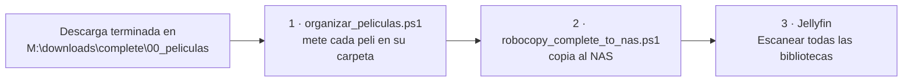

---
tags:
  - nas
  - jellyfin
  - scripts
  - powershell
creado: 2026-10-04
---

# Películas: del PC al NAS y a Jellyfin

Metodología para pasar las películas descargadas en el PC (`M:\downloads\complete`) al NAS UGREEN **ENDURANCE-ARK** y que Jellyfin las detecte correctamente.

## Resumen rápido



> [!tip] La rutina, en tres pasos
> 1. Abrir PowerShell y ejecutar `M:\organizar_peliculas.ps1` → escribir `SI`
> 2. Ejecutar `M:\robocopy_complete_to_nas.ps1` → escribir `SI`
> 3. En Jellyfin: **Panel de control → Escanear todas las bibliotecas**

Ambos scripts están guardados en `M:\`.

---

## Script 1 · `organizar_peliculas.ps1`

### Para qué sirve

Jellyfin identifica las películas por el **nombre de la carpeta** que las contiene. Las películas sueltas (un `.mp4` directamente en `00_peliculas`) las identifica mal o no las muestra.

Este script coge cada vídeo suelto y lo mete en su propia carpeta con el formato que espera Jellyfin:

```
00_peliculas\
├── Green Book.mp4                      ← antes
└── Green Book (2018)\
    └── Green Book.mp4                  ← después
```

### Qué hace y qué no hace

- **Mueve** los archivos (no copia). Dentro de la misma unidad es instantáneo.
- **No renombra** los archivos de vídeo: solo crea la carpeta.
- Mueve también los subtítulos o `.nfo` que tengan el mismo nombre base.
- Limpia el nombre: quita etiquetas tipo `@Todogram`, `1080p`, `hdrip`, `castellano`, etc., y saca el año.
- Ignora vídeos de menos de 200 MB (muestras, tráileres).
- **No sobrescribe nada.** Si la carpeta ya existe, la marca como `SALTAR`.
- Muestra una tabla con el plan y **pide escribir `SI`** antes de mover.
- Guarda el plan en un CSV en `M:\robocopy-logs\`.

### Cómo se ejecuta

En PowerShell:

```powershell
M:\organizar_peliculas.ps1
```

Por defecto trabaja en `M:\downloads\complete\00_peliculas`. Para usarlo en otra carpeta (por ejemplo directamente en el NAS), se le pasa la ruta:

```powershell
M:\organizar_peliculas.ps1 "\\ENDURANCE-ARK\media\00_peliculas"
```

### Configuración (al principio del script)

| Variable | Para qué |
|---|---|
| `$Simular` | `$true` = solo muestra la tabla, no mueve nada. `$false` = modo normal (tabla + pide `SI`). |
| `$TamanoMinimoMB` | Vídeos más pequeños se ignoran. Por defecto 200. |
| `$Correcciones` | Nombres de carpeta puestos a mano cuando el automático sale mal. |
| `$Ignorar` | Archivos que no se deben tocar nunca. |

### Cómo corregir un nombre que sale mal

Si en la tabla una película sale con un nombre raro o sin año, se añade una línea a `$Correcciones` con el **nombre completo del archivo** y la carpeta deseada:

```powershell
$Correcciones = @{
    ...
    "Emma Online.mp4" = "Emma Online (2024)"
}
```

> [!warning] Al editar el script
> - Guardar siempre como **UTF-8 con BOM** (Bloc de notas → Guardar como → Codificación). Si no, las tildes se rompen y las correcciones con tildes no coinciden.
> - **No borrar las correcciones que ya hay.** Son las mismas que se usaron en el NAS. Si se quitan, en `M:` saldrían carpetas con otro nombre y robocopy subiría esas películas **duplicadas**.

> [!caution] qBittorrent
> Si una película todavía se está compartiendo (*seeding*), al moverla qBittorrent la marcará como "archivos no encontrados". Organizar solo lo que ya haya terminado de compartir, o asumir que deja de compartirse.

---

## Script 2 · `robocopy_complete_to_nas.ps1`

### Para qué sirve

Copia todo el contenido de `M:\downloads\complete` al NAS `\\ENDURANCE-ARK\media`, categoría por categoría:

| Origen (PC) | Destino (NAS) |
|---|---|
| `M:\downloads\complete\00_peliculas` | `\\ENDURANCE-ARK\media\00_peliculas` |
| `M:\downloads\complete\01_series` | `\\ENDURANCE-ARK\media\01_series` |
| `...` | `...` |

### Qué hace y qué no hace

- **Copia** (no mueve): los originales se quedan en `M:`.
- **Solo copia archivos que no existan en el NAS.** Nunca sobrescribe ni borra nada.
- Excluye archivos temporales o a medio descargar (`.part`, `.!qB`, `.tmp`…).
- Si una carpeta de categoría no existe en el NAS, **avisa y la salta** (no crea carpetas nuevas salvo que se active `$CrearCarpetasNuevas`).
- Pide escribir `SI` antes de copiar.
- Guarda logs en `M:\robocopy-logs\<fecha>_complete_to_nas\`.

### Cómo se ejecuta

```powershell
M:\robocopy_complete_to_nas.ps1
```

Para solo ver qué copiaría, sin copiar nada: poner `$Simular = $true` en el script.

### Configuración

| Variable | Para qué |
|---|---|
| `$Simular` | `$true` = lista lo que haría (`/L`). `$false` = copia real. |
| `$Mapa` | Equivalencias si una carpeta se llama distinto en el PC y en el NAS. |
| `$CrearCarpetasNuevas` | `$false` (recomendado) = salta categorías que no existan en el NAS. |
| `$ArchivosExcluidos` | Extensiones de temporales que nunca se copian. |

> [!info] Limitación importante
> Como no sobrescribe nada, **si un archivo ya existe en el NAS pero es distinto** (otra versión, o una copia que se cortó a medias), el script lo salta siempre. Para detectarlos:
> ```powershell
> robocopy "M:\downloads\complete" "\\ENDURANCE-ARK\media" /E /L /FP /BYTES /XJ /NP /NDL /NJH /NJS |
>     Select-String "New File|Newer|Older|Changed|Modified"
> ```
> - `New File` → falta en el NAS (el script lo copiará).
> - `Newer` / `Older` / `Changed` → existe pero es distinto. Revisar a mano: si el del NAS está incompleto, borrarlo y volver a ejecutar el script.

---

## Jellyfin

- Corre en **Docker** en el NAS (app Docker de UGOS → Project `jellyfin`).
- Versión fijada: **`jellyfin/jellyfin:10.11.11`** (en el compose del Project).
- Biblioteca de películas: `/media/00_peliculas` (= `\\ENDURANCE-ARK\media\00_peliculas`).
- Configuración: carpeta compartida `docker/jellyfin/config`.

> [!danger] Regla de oro
> **No renombrar, mover ni borrar desde fuera de Jellyfin nada que Jellyfin ya tenga en la biblioteca** sin escanear justo después y comprobar que todo sigue apareciendo.
> En la 10.11.8, una sola carpeta renombrada (`Toy Story 5 (2026)` → `Toy Story 5`) rompía el escaneo entero y no aparecía **ninguna** película nueva.
> Añadir cosas nuevas no tiene ningún riesgo.

### Si algo nuevo no aparece en Jellyfin

1. Comprobar que el archivo está en el NAS y en su carpeta.
2. Docker (UGOS) → Container → `jellyfin` → **Terminal** → `/bin/bash` y ejecutar:
   ```bash
   grep -i -E "error|exception|denied" "/config/log/$(ls -t /config/log | head -1)" | tail -40
   ```
3. Interpretar:
   - `DirectoryNotFoundException ... '<ruta>'` → Jellyfin busca una carpeta que ya no existe (renombrada o borrada). Arreglo rápido: devolverle su nombre original y volver a escanear.
   - `UNIQUE constraint failed: UserData...` → bug de la base de datos al borrar entradas. Ver si hay versión nueva de Jellyfin.
   - `Permission denied` → problema de permisos en la carpeta compartida.

### Cómo actualizar Jellyfin

1. Abrir Jellyfin → Panel de control → anotar la versión actual.
2. Docker → Container → `jellyfin` → apagar con el interruptor.
3. **Copia de seguridad:** app Archivos → `docker/jellyfin` → copiar `config` como `config_backup`.
4. Docker → **Project** → `jellyfin` → **Compose configuration** → cambiar la versión en la línea:
   ```yaml
   image: jellyfin/jellyfin:10.11.11
   ```
5. **Redeploy** → marcar *Pull the latest image* → **Deploy**.
6. Comprobar versión, películas y usuarios.

> [!warning] No usar la etiqueta `latest` a ciegas
> `latest` apunta a la última versión mayor (12.x), que migra la base de datos y puede romper plugins. Subir de versión mayor solo con copia de seguridad hecha y leyendo antes las notas de la versión.

**Vuelta atrás:** parar el contenedor, sustituir `config` por `config_backup`, volver a poner la versión anterior en el compose y hacer *Redeploy*.

---

## Pendientes (a 2026-10-04)

- [ ] Toy Story 5 (2026): hay dos archivos dentro de la carpeta; borrar el duplicado.
- [ ] Borrar `El Final De La Calle Oak (2026) [Full 1080P] Hdts.mp4` (duplicado HDTS de *El final de Oak Street*) del NAS y de `M:`.
- [ ] A Prayer Before Dawn: revisar la carpeta `A Prayer Before Dawn [2017]` del NAS antes de organizar `M:` por primera vez, para no duplicarla.
- [ ] Moon Knight (01_series): 6 capítulos más nuevos en el PC que en el NAS; revisar cuál es la versión buena.
- [ ] Borrar `docker/jellyfin/config_backup` cuando Jellyfin 10.11.11 lleve unos días funcionando bien.
- [ ] Opcional: buscar el año de *Emma Online*, *Enfrentados Marfil*, *Retratos de una obsesión*, *Sin tregua* y *Mayhem* y usar **Identificar** en Jellyfin.
